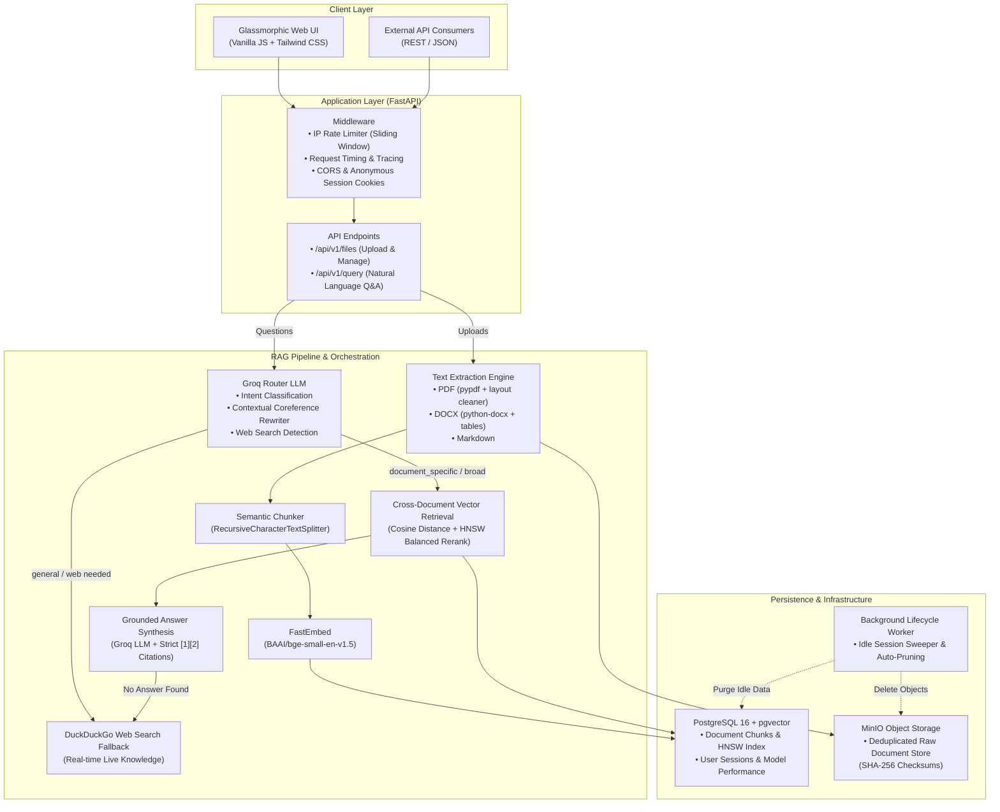

# Citely — Production-Ready RAG Document Intelligence System

[](src/__init__.py)
[](https://www.python.org/)
[](https://fastapi.tiangolo.com/)
[](https://github.com/pgvector/pgvector)
[](https://min.io/)
[](https://groq.com/)
[-4B8BBE?style=flat)](https://github.com/qdrant/fastembed)
[](LICENSE)

**Citely** is a full-stack, enterprise-grade Retrieval-Augmented Generation (RAG) platform designed for high-accuracy document intelligence. It supports single and cross-document reasoning, contextual coreference resolution, multi-document synthesis with page-level citations, automated intent routing, and real-time web search fallback.

---

## Architecture Overview



---

## Key Features & Engineering Highlights

### 1. Intelligent Query Routing & Query Rewriting
- **Intent Routing**: Classifies queries into `document_specific`, `document_broad` (comparisons, summaries across files), or `general` via Groq-accelerated models using strict JSON schemas.
- **Coreference Resolution**: Rewrites queries referencing conversational context (e.g., *"What did it cost?"* -> *"What did the project budget cost in the 2024 financial report?"*) so retrieval vectors remain contextually complete without bloating embedding prompts.
- **Live Knowledge Detection**: Intelligently flags queries that require up-to-the-minute real-world data (`needs_web=True`), invoking search only when necessary.

### 2. High-Precision Grounded Ingestion & Retrieval
- **Multi-Format Ingestion**: Robust parsers for PDF (with layout whitespace correction and hyphen repair), DOCX (extracting both flowing paragraphs and structured tabular data), and Markdown.
- **Fast Local Vectorization**: Powered by `FastEmbed` (`BAAI/bge-small-en-v1.5`, 384 dimensions) running asynchronously via thread pools to keep the event loop non-blocking.
- **HNSW Vector Search with Cosine Distance**: Leverages native PostgreSQL `pgvector` indexing with cosine distance (`<==>`) for sub-millisecond retrieval.
- **Cross-Document Balanced Retrieval**: For workspace queries spanning multiple documents, retrieval dynamically balances top candidate chunks across all uploaded files to synthesize relational concepts rather than skewing toward a single file.
- **Strict Verifiable Citations**: Enforces structured citation brackets (`[1]`, `[2]`) tied directly to original document names and page numbers. Hallucination is prevented by falling back if context is insufficient.

### 3. Graceful Hybrid Fallback
- If documents do not contain the answer, or if the user asks broad general questions, Citely routes the query to a fallback general LLM pipeline.
- When current events or temporal data are required, DuckDuckGo web search executes in real time, summarizing numbered web citations seamlessly.

### 4. Privacy-Preserving Ephemeral Sessions & Data Lifecycle
- **Zero Login Friction**: Anonymous browser sessions tracked via secure, HTTP-only, SameSite cookies.
- **Automated Lifecycle Sweeper**: An adaptive background worker monitors user inactivity. Sessions idle beyond the threshold (`CLEANUP_IDLE_MINUTES`) have all their files, vector embeddings, chunks, and MinIO storage objects permanently wiped.
- **Adaptive Execution**: The scheduler automatically sleeps when the database is empty, consuming zero resources when idle.

### 5. Production Reliability & Security
- **IP-Based Sliding-Window Rate Limiting**: Independent in-memory rate limiters for query endpoints and CPU-heavy upload endpoints to protect against DDoS or token exhaustion.
- **Request Tracing & Observability**: Custom middleware annotates every response with `X-Process-Time-Ms`, captures client IP/session tokens, and logs structured latency metrics.
- **Model Performance Instrumentation**: Built-in schema (`ModelPerformance`) to benchmark ingestion latencies, embedding durations, retrieval cosine similarity scores, and LLM token counts.

---

## Tech Stack

| Domain | Technology | Description |
|---|---|---|
| **Backend Framework** | **FastAPI** (Python 3.11+) | Async REST API with OpenAPI documentation |
| **Vector DB / Relational** | **PostgreSQL 16 + pgvector** | Vector similarity search (HNSW index) & relational metadata |
| **Object Storage** | **MinIO (S3 Compatible)** | Secure document blob storage with SHA-256 deduplication |
| **Embeddings** | **FastEmbed (BGE-small-en-v1.5)** | 384-dimensional dense semantic vectors |
| **LLM Inference** | **Groq API** (`gpt-oss-120b`, `gpt-oss-20b`) | Ultra-fast token generation and structured routing |
| **ORM & Migrations** | **SQLAlchemy 2.0 (Async) + Alembic** | Async database access via `asyncpg` driver |
| **Orchestration** | **LangChain Core & Text Splitters** | Prompt templating & recursive character chunking |
| **Web Fallback** | **DuckDuckGo Search (`ddgs`)** | Real-time web knowledge integration |
| **Frontend** | **Tailwind CSS + Vanilla JS** | Single-page responsive interface embedded in FastAPI |

---

## Repository Structure

```
RAG-doc Q&A/
├── docker-compose.yml         # Container configuration for PostgreSQL (pgvector) & MinIO
├── alembic.ini                # Alembic database migration configuration
├── .bumpversion.cfg           # Semantic versioning configuration
├── .env.example               # Template for environment configuration
├── .gitignore                 # Git ignore rules
│
├── alembic/                   # Database schema migration revisions
│   ├── env.py                 # Async Alembic execution harness
│   └── script.py.mako
│
├── scripts/                   # Utility scripts
│   └── bump_version.py        # Automated SemVer bumper (patch, minor, major)
│
├── src/                       # Backend Application Source Code
│   ├── requirements.txt       # Project dependencies & package versions
│   ├── main.py                # FastAPI entry point, lifespan, middleware & static mounts
│   ├── config.py              # Pydantic BaseSettings strict environment loader
│   ├── deps.py                # FastAPI dependency injection (DB sessions, cookies)
│   ├── middleware.py          # Request timing, logging & session tagging
│   ├── logging_config.py      # Structured uvicorn log configuration
│   │
│   ├── db/                    # Database models and connection
│   │   ├── models.py          # SQLAlchemy ORM models (UserSession, UploadedFile, DocumentChunk, ModelPerformance)
│   │   └── session.py         # Async engine and sessionmaker
│   │
│   ├── routes/                # REST API Routers
│   │   ├── files.py           # Document upload, listing, download & deletion endpoints
│   │   └── query.py           # Natural language query processing & cross-file RAG
│   │
│   ├── schemas/               # Pydantic v2 Request & Response DTOs
│   │   ├── file.py            # UploadedFile DTOs
│   │   └── query.py           # Query input/output, ChatTurn, and Source citations
│   │
│   └── services/              # Core Domain Services & Business Logic
│       ├── router.py          # LLM query routing, coreference resolution & intent classification
│       ├── retrieval.py       # Cosine similarity vector search & multi-doc balance
│       ├── generation.py      # Grounded LLM answering with passage citations
│       ├── general.py         # General knowledge LLM & DuckDuckGo web search fallback
│       ├── embeddings.py      # FastEmbed model wrapper (passages and query vectors)
│       ├── chunking.py        # Recursive text splitting with boundary preservation
│       ├── extraction.py      # Text & table extraction for PDF, DOCX, and Markdown
│       ├── processing.py      # Background worker orchestrating file ingestion
│       ├── file_service.py    # MinIO file management & DB transaction helpers
│       ├── storage.py         # MinIO S3 SDK wrapper (buckets, puts, gets)
│       ├── scheduler.py       # Automated idle-session garbage collection worker
│       ├── sessions.py        # Anonymous session creation & HTTP-only cookies
│       └── rate_limit.py      # Sliding-window IP rate limiter
│
└── frontend/                  # Modern Glassmorphic Web Client
    ├── index.html             # Application layout, chat interface & document panel
    ├── css/styles.css         # Custom animations, scrollbars & glassmorphism styling
    └── js/
        ├── api.js             # Client API service communicating with FastAPI
        └── app.js             # UI state management, chat rendering & file uploads
```

---

## Getting Started

### Prerequisites

- **Python**: `3.11+`
- **Docker & Docker Compose**: For PostgreSQL (pgvector) and MinIO storage
- **Groq API Key**: Obtain a free API key from [Groq Console](https://console.groq.com/)

---

### Step 1: Clone the Repository

```bash
git clone <repository-url>
cd "RAG-doc Q&A"
```

---

### Step 2: Launch Database & Storage Services

Run PostgreSQL with `pgvector` and MinIO via Docker Compose:

```bash
docker compose up -d
```

Verify services are running:
- **PostgreSQL**: `localhost:5432` (User: `rag`, Database: `ragdb`)
- **MinIO S3 API**: `localhost:9000`
- **MinIO Web Console**: `http://localhost:9001` (User: `minioadmin`, Password: `password`)

---

### Step 3: Configure Environment Variables

Create your local `.env` file from the provided `.env.example`:

```bash
cp .env.example .env
```

Open `.env` and configure your Groq API credentials:

```dotenv
GROQ_API_KEY=gsk_your_groq_api_key_here
GENERAL_GROQ_API_KEY=gsk_your_secondary_groq_key_or_same_key
```

*(All other settings have production-ready local defaults pre-configured.)*

---

### Step 4: Install Dependencies & Run Database Migrations

Set up a virtual environment and install dependencies:

```bash
python3 -m venv venv
source venv/bin/activate  # On Windows: venv\Scripts\activate

pip install -r src/requirements.txt
```

Apply database schema migrations:

```bash
alembic upgrade head
```

---

### Step 5: Start the Application

Launch the FastAPI application with Uvicorn:

```bash
uvicorn src.main:app --reload --port 8000
```

The application will start on `http://localhost:8000`:
- **Web Interface**: `http://localhost:8000/`
- **Interactive API Docs (Swagger UI)**: `http://localhost:8000/docs`
- **Alternative API Docs (ReDoc)**: `http://localhost:8000/redoc`
- **Health Check**: `http://localhost:8000/health`

---

## API Reference

### Document Management

| Method | Endpoint | Description |
|---|---|---|
| `POST` | `/api/v1/file` | Upload a single document (`PDF`, `DOCX`, `MD`) |
| `POST` | `/api/v1/files` | Batch upload multiple documents simultaneously |
| `GET` | `/api/v1/files` | List all documents belonging to the current session |
| `GET` | `/api/v1/file/{file_id}` | Fetch processing status (`pending`, `processing`, `ready`, `failed`) |
| `GET` | `/api/v1/file/{file_id}/download` | Download the original document from MinIO |
| `DELETE` | `/api/v1/file/{file_id}` | Delete document, chunks, and storage object |

### Natural Language Querying

| Method | Endpoint | Description |
|---|---|---|
| `POST` | `/api/v1/query` | Query across all documents in the session |
| `POST` | `/api/v1/query?file_id={id}` | Query targeting a specific document |

#### Query Request Payload:
```json
{
  "question": "What are the major revenue drivers described in the report?",
  "history": [
    {
      "role": "user",
      "content": "Can you summarize the Q3 financial results?"
    },
    {
      "role": "assistant",
      "content": "In Q3, total revenues increased by 14% year-over-year [1]."
    }
  ]
}
```

#### Query Response Payload:
```json
{
  "file_id": "3fa85f64-5717-4562-b3fc-2c963f66afa6",
  "filename": "Q3_Financial_Report.pdf",
  "files_searched": ["Q3_Financial_Report.pdf"],
  "question": "What are the major revenue drivers described in the report?",
  "route": "document_specific",
  "rewritten_question": "What are the major revenue drivers described in the Q3 Financial Report?",
  "answer_source": "document",
  "answer": "The primary revenue drivers were enterprise cloud subscriptions and AI infrastructure expansions [1], which grew by 32% [2].",
  "sources": [
    {
      "number": 1,
      "chunk_index": 12,
      "score": 0.8421,
      "content": "Enterprise cloud services drove over 45% of total segment revenue...",
      "file_id": "3fa85f64-5717-4562-b3fc-2c963f66afa6",
      "filename": "Q3_Financial_Report.pdf",
      "page_number": 4
    }
  ],
  "web_sources": []
}
```

---

## Key Design Patterns & Engineering Highlights

- **Non-Blocking Ingestion Pipeline**: File reading, text extraction, splitting, and vector embedding are delegated to worker threads via `asyncio.to_thread`, preserving event-loop responsiveness under concurrent load.
- **Strict Citation Grounding**: The LLM prompt explicitly restricts answers to numbered context passages. If facts cannot be validated directly from retrieved chunks, the system cleanly triggers fallback modes instead of fabricating information.
- **Resource Cleanup Efficiency**: Rather than continuous busy-waiting, the idle session cleaner is event-driven—activating upon document upload and terminating when no sessions remain.
- **Strict Separation of Concerns**: Clean modular separation across routing (`src/routes`), schemas (`src/schemas`), database models (`src/db`), and business logic (`src/services`).

---


